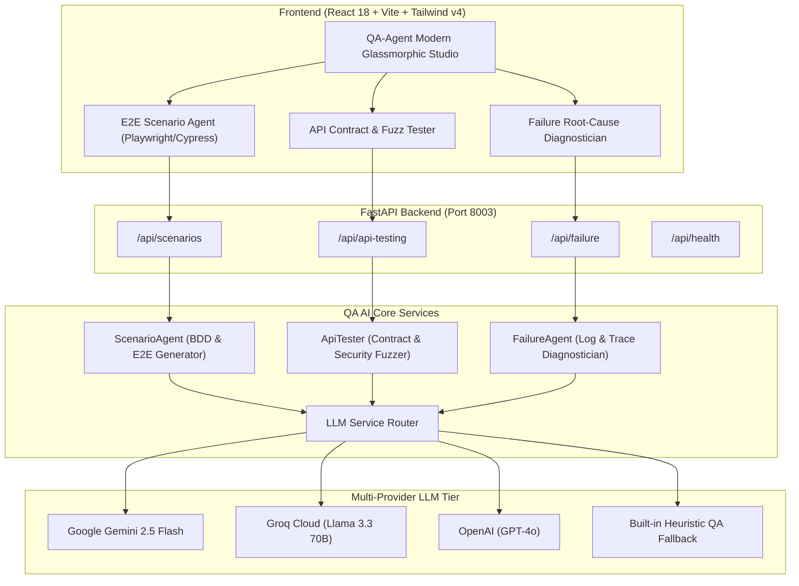

# QA-Agent 🛡️🤖

> **Autonomous AI Quality Assurance & Test Engineering Studio**  
> Synthesize BDD Gherkin scenarios, generate executable Playwright / Cypress E2E automation suites, fuzz API contracts with boundary & security payloads, and diagnose test execution stack traces with automated patch suggestions.

[](https://fastapi.tiangolo.com)
[](https://www.python.org/)
[](https://react.dev/)
[](https://vitejs.dev/)
[](https://tailwindcss.com/)
[](https://playwright.dev/)
[](https://ai.google.dev/)
[](LICENSE)

---

## 🌟 Overview

**QA-Agent** is an enterprise-grade AI quality engineering workspace designed for SDETs, software engineers, and QA leads. It bridges the gap between natural language requirements, automated testing suites, API contract hardening, and CI/CD triage:

1. **BDD Scenario & E2E Synthesizer**: Converts product stories into Gherkin feature files and ready-to-run Playwright (`.spec.ts`) or Cypress (`.cy.js`) automation scripts.
2. **API Contract & Security Fuzzer**: Dissects REST endpoints and generates boundary assertions, negative contract checks, authentication edge-cases, SQLi/XSS injection vectors, executable Python Pytest scripts, and instant cURL commands.
3. **Failure Root-Cause Diagnostician**: Accepts raw stack traces, Playwright element timeouts, or pytest crashes, determines the precise failure taxonomy (Confidence Score 0-100%), and outputs an exact code fix and prevention checklist.
4. **Resilient Multi-LLM Engine**: First-class support for **Google Gemini 2.5 Flash**, **Groq (Llama 3.3)**, and **OpenAI (GPT-4o)**, plus a high-fidelity **Offline Heuristic Synthesis Engine** that operates seamlessly with zero API keys required.

---

## 🏛️ System Architecture



---

## 🚀 Key Modules

### 1. E2E Scenario Agent (BDD & Automation)
* **Inputs**: Natural language user story or acceptance criteria.
* **Outputs**:
  * Formal Gherkin feature blocks (`Feature`, `Scenario`, `Given`, `When`, `Then`).
  * Executable Playwright TypeScript or Cypress JavaScript test suites.
  * Environment setup & execution commands (`npx playwright test`).

### 2. API Contract & Security Fuzz Tester
* **Inputs**: Target HTTP method (`GET`, `POST`, `PUT`, `DELETE`), endpoint URI, and sample payload.
* **Outputs**:
  * Comprehensive matrix of positive contract validation, negative schema tests, and security fuzzing payloads (SQL injection, XSS vectors, oversized buffers).
  * Standalone executable Python `test_api_contract.py` script.
  * 1-Click copyable `cURL` commands for terminal verification.

### 3. Failure Root-Cause Diagnostician
* **Inputs**: Playwright locator timeouts, Pytest assertion failures, or 500 server stack traces.
* **Outputs**:
  * Error categorization (`ElementNotFound`, `AssertionFailure`, `ServerError500`, `NetworkTimeout`).
  * Diagnosis confidence gauge (0–100%).
  * Root-cause breakdown explaining *why* it failed.
  * Direct code patch snippet ready to commit.
  * Flakiness and regression prevention checklist.

---

## 📁 Repository Structure

```
QA-Agent/
│
├── backend/
│   ├── app/
│   │   ├── main.py                   # FastAPI Application & CORS configuration
│   │   │
│   │   ├── routes/
│   │   │   ├── e2e_scenarios.py      # BDD & Playwright scenario endpoints
│   │   │   ├── api_testing.py        # API contract & fuzz test endpoints
│   │   │   └── failure_analyzer.py   # Test trace root-cause diagnosis endpoints
│   │   │
│   │   ├── services/
│   │   │   ├── llm_service.py        # Gemini, Groq, OpenAI & offline fallback
│   │   │   ├── scenario_agent.py     # BDD Gherkin & Playwright generator
│   │   │   ├── api_tester.py         # API contract validator & security fuzzer
│   │   │   └── failure_agent.py      # Log parsing & diagnostic engine
│   │   │
│   │   ├── models/
│   │   │   └── schemas.py            # Pydantic v2 validation models
│   │   │
│   │   └── prompts/
│   │       ├── bdd_scenario_prompt.txt
│   │       ├── api_fuzz_prompt.txt
│   │       └── failure_diagnosis_prompt.txt
│   │
│   ├── requirements.txt              # FastAPI, Pydantic, Requests, Uvicorn
│   └── .env.example                  # Port 8003 & API key templates
│
├── frontend/
│   ├── src/
│   │   ├── components/
│   │   │   ├── ScenarioBuilder.jsx   # BDD & Playwright generation studio
│   │   │   ├── ApiTester.jsx         # API contract & fuzz test UI
│   │   │   └── FailureAnalyzer.jsx   # Stack trace diagnostic UI
│   │   │
│   │   ├── pages/
│   │   │   └── Home.jsx              # Studio navigation & feature tabs
│   │   │
│   │   ├── App.jsx                   # Global navbar, health check & LLM selector
│   │   ├── main.jsx                  # React DOM entry point
│   │   └── index.css                 # Tailwind CSS v4 styling & dark theme
│   │
│   ├── index.html
│   ├── package.json                  # React 18, Vite 6, Tailwind v4, Lucide
│   └── vite.config.js                # Port 5176 with /api proxy to 8003
│
├── tests/
│   └── sample_test_plan.json         # Reference scenarios, APIs & error logs
│
├── run_backend.bat                   # 1-Click Windows backend starter
├── run_frontend.bat                  # 1-Click Windows frontend starter
├── push_to_github.bat                # 1-Click GitHub deployment script
├── .gitignore
├── README.md
└── LICENSE                           # MIT License
```

---

## ⚡ Quickstart Guide

### Prerequisites
* **Python**: 3.10 or higher
* **Node.js**: 18.0 or higher
* **Git** installed on your system

### 1. One-Click Launch (Windows)
Open two terminal tabs or double-click:
1. `run_backend.bat` — Starts FastAPI server on `http://localhost:8003`
2. `run_frontend.bat` — Starts Vite UI on `http://localhost:5176`

---

### 2. Manual Setup

#### Backend Setup
```bash
cd backend

# Create virtual environment (optional)
python -m venv venv
venv\Scripts\activate      # On Windows
# source venv/bin/activate # On macOS/Linux

# Install dependencies
pip install -r requirements.txt

# Configure environment variables (optional)
cp .env.example .env

# Run FastAPI backend
uvicorn app.main:app --host 0.0.0.0 --port 8003 --reload
```

#### Frontend Setup
```bash
cd frontend

# Install npm packages
npm install

# Start development server
npm run dev
```

Visit **`http://localhost:5176`** in your browser!

---

## 🔌 API Reference

| Method | Endpoint | Description |
|---|---|---|
| `GET` | `/api/health` | Service health status, active provider & version info |
| `POST` | `/api/scenarios/generate` | Generate Gherkin scenarios & Playwright/Cypress automation code |
| `GET` | `/api/scenarios/presets` | Retrieve sample user stories for quick testing |
| `POST` | `/api/api-testing/generate` | Generate contract tests, security fuzzing & Python script |
| `GET` | `/api/api-testing/presets` | Retrieve sample REST API configurations |
| `POST` | `/api/failure/diagnose` | Analyze test failure stack trace & provide code fix |
| `GET` | `/api/failure/presets` | Retrieve sample failure logs (Playwright timeout, Pytest error) |
| `GET` | `/docs` | Interactive Swagger API documentation |

---

## 🌐 AI Ecosystem Port Allocation

To guarantee zero port collisions across the full AI project suite:

| Project | Backend Port | Frontend Port | Focus Area |
|---|---|---|---|
| **ResumeGPT** | `8000` | `5173` | AI Resume Analysis, ATS Scoring & Enhancement |
| **SQLAgent Pro** | `8001` | `5174` | Autonomous Text-to-SQL & Analytics Agent |
| **TestGenie AI** | `8002` | `5175` | Unit Test Generation & Static Bug Auditing |
| **QA-Agent** | `8003` | `5176` | E2E Testing, API Contract Fuzzing & Failure Diagnosis |

---

## 🤝 Contributing

Contributions, bug reports, and feature suggestions are welcome!
1. Fork the Project
2. Create your Feature Branch (`git checkout -b feature/AmazingFeature`)
3. Commit your Changes (`git commit -m 'feat: add amazing feature'`)
4. Push to the Branch (`git push origin feature/AmazingFeature`)
5. Open a Pull Request

---

## 📄 License

Distributed under the **MIT License**. See [`LICENSE`](LICENSE) for more information.
